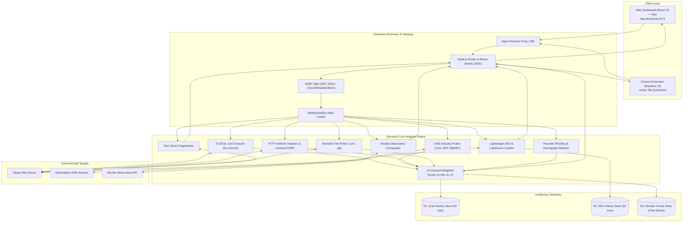

# 🛡️ SecureIX — Multi-Vector Web Security, Phishing & SEO Analyzer

## 🌟 Executive Overview

**SecureIX** is an enterprise-grade web security and intelligence platform that combines **security posture auditing, phishing detection, technology fingerprinting, HTTP/TLS analysis, and technical SEO auditing** into a unified, lightweight assessment workflow.

### Core Capabilities

- **10-Vector Security Auditing**: Real-time evaluation of SSL/TLS certificate chains, HTTP security headers, DNS anti-spoofing policies (CAA, SPF, DMARC, DNSSEC), cookie/CORS policies, sensitive path exposures (`.env`, `.git`), and heuristic phishing indicators.
- **Mozilla Observatory Benchmarking**: Side-by-side comparative analysis matching target configurations against standard Mozilla Observatory rules.
- **Technology Stack Profiling**: Fingerprints web servers, frontend frameworks, content management systems (CMS), CDNs, and cloud hosting infrastructure.
- **Technical SEO & Lighthouse Simulation**: Audits meta tags, OpenGraph data, crawlability, DOM structure, and simulates Core Web Vitals.
- **Multi-Surface Access**: Accessible via a high-performance **React Web Application**, an **unpacked Chrome Extension**, and a RESTful **HTTP API**.
- **Client-Side PDF Dossier Generation**: Exports formal branded security audit reports directly from the browser using `jspdf` and `jspdf-autotable`.

---

## 🏗️ System Architecture & Data Flow



---

## 📦 Repository Components

### 1. Backend Engine (`backend/`)

- **Zero External Dependencies**: Implemented strictly with Node.js standard runtime libraries (`http`, `https`, `tls`, `dns`, `net`, `crypto`, `url`, `fs`, `path`). No supply-chain attack risks.
- **Perimeter Defense**: Strict SSRF firewall blocking private subnets (`10.0.0.0/8`, `172.16.0.0/12`, `192.168.0.0/16`), loopback (`127.0.0.1`), link-local/cloud instance metadata (`169.254.169.254`), and dangerous schemes (`javascript:`, `file:`, `data:`).
- **Sliding-Window Rate Limiting**: Client IP request tracking with standard `X-RateLimit-*` and `Retry-After` headers.
- **Self-Defense Security Headers**: Every HTTP response is automatically protected with strict Content Security Policy, `X-Frame-Options: DENY`, `X-Content-Type-Options: nosniff`, and Cross-Origin Opener Policy.
- _Detailed documentation:_ [backend/README.md](backend/README.md)

### 2. Frontend Web Application (`frontend/`)

- **Modern Stack**: Built with React 19, Vite 8, and Tailwind CSS 3.
- **Neo-Brutalist / Cyberpunk Aesthetics**: High-contrast, dynamic dashboard with micro-animations, radar scanners, and live score badges.
- **Reactive Custom Hooks**: `useScanner`, `useTechStack`, `useSeoScanner`, and `useScanHistory` for concurrent scanning state management.
- **Interactive Data Visualization**: Historical domain trends plotted with `Chart.js` and `react-chartjs-2`.
- **Exportable PDF Dossiers**: Full branded security reports rendered directly in the browser via `jspdf` and `jspdf-autotable`.
- _Detailed documentation:_ [frontend/README.md](frontend/README.md)

### 3. Chrome Browser Extension (`extension/`)

- **Manifest V3 Architecture**: Lightweight browser extension with background service worker (`background.js`) and persistent options in `chrome.storage.local`.
- **One-Click Active Tab Discovery**: Automatically reads and verifies the active tab with zero typing required.
- **Dynamic Toolbar Badges**: Dynamically flags tab security in real-time (`SEC` for HTTPS, `!` for unencrypted HTTP).
- **3-in-1 QuickScan**: Simultaneously audits security, detects the hosting tech stack, and measures SEO metrics from the browser toolbar.
- _Detailed documentation:_ [extension/README.md](extension/README.md)

### 4. Architecture & Threat Documentation (`docs/`)

- **STRIDE Threat Model**: Formal threat modeling specifications aligned with OWASP Top 10 and NIST SP 800-115 ([docs/THREAT_MODEL_STRIDE.md](docs/THREAT_MODEL_STRIDE.md)).
- **Data Flow Diagrams (DFD & UFD)**: Complete Level 0 Context, Level 1 System, and Level 2 Decomposed Process specifications ([docs/DATA_FLOW_DIAGRAM_UDF.md](docs/DATA_FLOW_DIAGRAM_UDF.md)).
- **Interactive Diagram Viewer**: Standalone HTML page with live SVG rendering for visual diagram inspection and PDF export ([docs/diagrams.html](docs/diagrams.html)).

---

## 🎯 10-Vector Security Evaluation Engine

Every scan orchestrates concurrent audits across 10 specialized security vectors:

| #      | Security Vector                          | Checks Performed                                                                                         | Scoring Weight |
| ------ | ---------------------------------------- | -------------------------------------------------------------------------------------------------------- | -------------- |
| **1**  | **SSL / TLS Certificate**                | Issuer validity, expiration countdown, protocol version, SAN match, self-signed detection                | 15%            |
| **2**  | **HSTS Enforcement**                     | `Strict-Transport-Security` presence, `max-age` duration, `includeSubDomains`, `preload`                 | 10%            |
| **3**  | **Content Security Policy (CSP)**        | Directives strength, `default-src`, `script-src`, absence of `'unsafe-inline'` / `'unsafe-eval'`         | 15%            |
| **4**  | **Clickjacking Defense**                 | `X-Frame-Options` (`DENY` / `SAMEORIGIN`), CSP `frame-ancestors` directive                               | 10%            |
| **5**  | **MIME-Sniffing Defense**                | `X-Content-Type-Options: nosniff` validation                                                             | 5%             |
| **6**  | **Referrer & Permissions**               | `Referrer-Policy` strictness, `Permissions-Policy` hardware feature restrictions                         | 5%             |
| **7**  | **Cookie Hardening**                     | `Set-Cookie` inspection for `Secure`, `HttpOnly`, and `SameSite` (`Lax`/`Strict`) flags                  | 10%            |
| **8**  | **CORS Rigidity**                        | `Access-Control-Allow-Origin` wildcard checks, credential exposure verification                          | 5%             |
| **9**  | **DNS Anti-Spoofing**                    | DNS records lookup: CAA policy, SPF authorization, DMARC enforcement, DNSSEC status                      | 10%            |
| **10** | **Sensitive File & Phishing Heuristics** | Exposed file probing (`.env`, `.git/HEAD`, `wp-config.php`, `id_rsa`), punycode homographs, IP hostnames | 15%            |

### Grading Scale

$$\text{Total Score} = \sum_{i=1}^{10} \text{Earned Channel Weight}_i \quad (0 \le \text{Score} \le 100)$$

- **A+ (95–100)**: Exemplary posture, maximum hardening across all channels.
- **A (90–94)**: Excellent security posture, minor configuration improvements possible.
- **B (80–89)**: Good baseline defense; missing optional headers or weak cookie policies.
- **C (65–79)**: Fair posture; vulnerable to clickjacking, missing HSTS or weak CSP.
- **D (50–64)**: Poor posture; critical headers absent, sensitive cookies unflagged.
- **F (0–49)**: Critical risk; non-HTTPS, sensitive files exposed, or phishing heuristics flagged.

---

## 🛡️ Self-Defense & Abuse Safeguards

Because an automated scanner accepts arbitrary target URLs and makes outbound requests, the backend implements defense-in-depth safeguards:

```text
[Incoming Request]
       │
       ▼
[Length & Format Check] ──> Reject if > 2048 chars or malformed
       │
       ▼
[Scheme Whitelist] ───────> Only 'http:' and 'https:' allowed (Blocks file:, gopher:, ftp:)
       │
       ▼
[SSRF Firewall] ──────────> Blocks:
                              • Loopback: 127.0.0.0/8, ::1, localhost
                              • RFC 1918 Private: 10.0.0.0/8, 172.16.0.0/12, 192.168.0.0/16
                              • Link-Local / Cloud Metadata: 169.254.169.254, 0.0.0.0/8
       │
       ▼
[Sliding-Window Limiter] ─> 429 Too Many Requests if client exceeds window threshold
       │
       ▼
[Network Probe Guards] ───> 5-second socket timeout, max 5 redirect depth
```

---

## 🔌 API Reference

The backend exposes clean REST endpoints accessible by any client:

| Method       | Endpoint               | Query / Body Params   | Description                                                                  |
| ------------ | ---------------------- | --------------------- | ---------------------------------------------------------------------------- |
| `GET`        | `/api/health`          | -                     | Liveness and healthcheck probe                                               |
| `GET`        | `/api/security-status` | -                     | Active defense shields, SSRF filters, and client rate-limit status           |
| `GET`        | `/api/scan`            | `url` _(required)_    | Executes multi-vector security scan and returns score, grade, and findings   |
| `GET`        | `/api/techstack`       | `url` _(required)_    | Analyzes HTTP headers and HTML fingerprints to detect frameworks and servers |
| `GET`        | `/api/benchmark`       | `url` _(required)_    | Compares target score side-by-side with Mozilla Observatory standards        |
| `GET`        | `/api/history`         | -                     | Returns the last 50 recorded scans                                           |
| `GET`        | `/api/history/trend`   | `domain` _(required)_ | Returns historical security score time-series for a specific domain          |
| `POST`/`GET` | `/api/seo/analyze`     | `url` _(required)_    | Crawls HTML to evaluate SEO metadata, OpenGraph, and performance metrics     |
| `GET`        | `/api/seo/history`     | -                     | Returns recent SEO audit history records                                     |

---

## 🚀 Quick Start Guide

### Native Local Development

#### 1. Start the Backend API

```bash
cd backend

# No npm install required! Zero third-party dependencies.
# Development mode with native Node.js file watcher:
npm run dev

# Server runs on http://localhost:3000
```

#### 2. Start the Frontend Application

```bash
cd frontend

# Install frontend dependencies
npm install

# Start the Vite development server
npm run dev

# Dashboard runs on http://localhost:5173
```

---

### Option C: Chrome Extension Installation

1. Open **Google Chrome** (or Edge, Brave, Chromium).
2. Navigate to `chrome://extensions/` in the URL bar.
3. Enable **Developer mode** via the toggle switch in the top-right corner.
4. Click **"Load unpacked"** in the top-left corner.
5. Select the `extension/` directory from this repository:
   ```text
   web-security-analyzer/extension
   ```
6. The **SecureIX — Quick Security Scanner** icon will appear in your extensions toolbar. Click to pin it.

---

## 📁 Project Directory Layout

```text
web-security-analyzer/
├── backend/                     # Zero-dependency Node.js Analysis Engine
│   ├── config/env.js            # Environment config & zero-dep .env loader
│   ├── controllers/             # API request handlers (scan, techstack, seo, bench)
│   ├── middleware/              # SSRF defense, URL sanitizer, rate limiter
│   ├── routes/router.js         # HTTP dispatcher, CORS & static fallback
│   ├── seo/                     # Crawler, HTML parser & Lighthouse simulator
│   ├── services/                # TLS certs, DNS sec, sensitive files, heuristics
│   ├── storage/historyStore.js  # In-memory circular history & domain trends
│   ├── index.js                 # Server entry point
│   └── package.json
│
├── frontend/                    # React 19 + Vite + Tailwind CSS Web App
│   ├── public/                  # Static assets & icons
│   ├── src/
│   │   ├── components/          # UI components (Hero, Navbar, TechStack, SEO)
│   │   ├── hooks/               # Custom hooks (useScanner, useSeoScanner)
│   │   ├── utils/               # PDF export service & helpers
│   │   ├── App.jsx              # Main dashboard layout
│   │   └── index.css            # Global Tailwind styling
│   ├── nginx.conf               # Reverse proxy config (/api/* -> backend:3000)
│   └── vite.config.js
│
├── extension/                   # Chrome Extension (Manifest V3)
│   ├── icons/                   # High-res extension icons (16, 32, 48, 128 px)
│   ├── background.js            # Service worker (tab tracking & badge manager)
│   ├── manifest.json            # V3 extension manifest & permissions
│   ├── popup.html               # Extension popup markup
│   ├── popup.css                # Neo-brutalist styling
│   └── popup.js                 # Active-tab detection & scan controller
│
├── docs/                        # Academic Architecture & Threat Modeling Specs
│   ├── THREAT_MODEL_STRIDE.md   # STRIDE threat model & DREAD risk assessment
│   ├── DATA_FLOW_DIAGRAM_UDF.md # Level 0/1/2 DFD & User Flow Diagrams
│   └── diagrams.html            # Standalone interactive SVG diagram viewer
│
└── README.md                    # Repository master documentation
```

---
