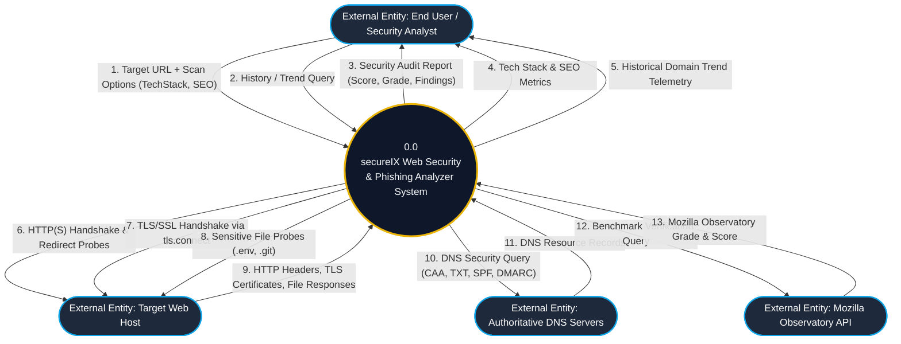
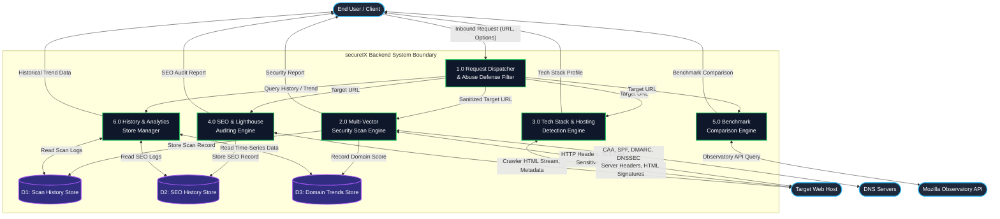
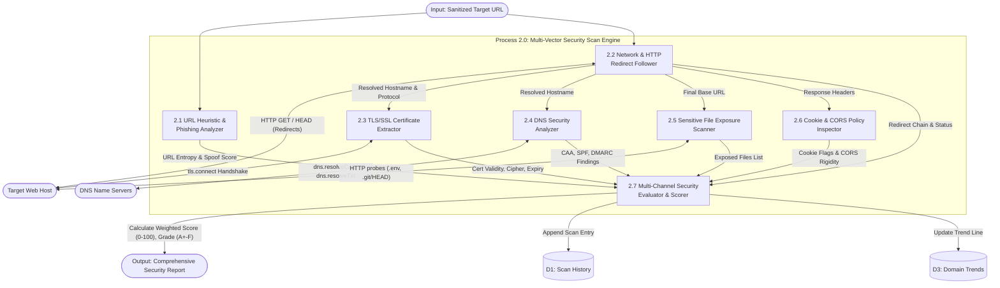
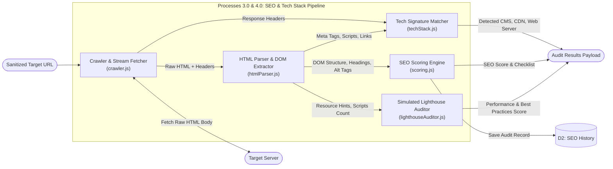

# 📊 System Architecture: Data Flow Diagrams (DFD) & User Flow Diagrams (UDF)

**Project Name:** SecureIX — Multi-Vector Web Security & Phishing Analyzer  
**Component:** Backend & Distributed Analysis Engine  
**Classification:** Academic & Software Engineering Specification (University IS Project)  
**Standard:** Yourdon & Coad / Gane & Sarson DFD Notation & UML User Flow Specifications

---

## 📑 Table of Contents

1. [Executive Overview](#1-executive-overview)
2. [Level 0: Context Data Flow Diagram (Context DFD)](#2-level-0-context-data-flow-diagram-context-dfd)
3. [Level 1: System-Wide Data Flow Diagram (Level 1 DFD)](#3-level-1-system-wide-data-flow-diagram-level-1-dfd)
4. [Level 2: Decomposed Sub-Process Data Flow Diagrams](#4-level-2-decomposed-sub-process-data-flow-diagrams)
   - [4.1 Security Scanning Engine (P2.0 Decomposition)](#41-security-scanning-engine-p20-decomposition)
   - [4.2 SEO & Tech Stack Engine (P3.0 & P4.0 Decomposition)](#42-seo--tech-stack-engine-p30--p40-decomposition)
5. [User Flow Diagram (UFD) / End-to-End User Journey](#5-user-flow-diagram-ufd--end-to-end-user-journey)
6. [Data Dictionary & Data Stores (D1, D2, D3)](#6-data-dictionary--data-stores-d1-d2-d3)
7. [Trust Boundaries & Security Safeguards](#7-trust-boundaries--security-safeguards)

---

## 1. Executive Overview

The **SecureIX Web Security Analyzer** backend is a zero-dependency, event-driven Node.js system designed to receive untrusted target URLs, apply defensive sanitization, orchestrate multi-vector security evaluations across outbound networks (HTTP, TLS, DNS), and persist historical audit telemetry.

This document formally captures the **Data Flow Diagrams (DFD)** from Context Level 0 down to detailed Level 2 sub-processes, along with the **User Flow Diagram (UFD)** representing user and system interactions.

### External Entities

- **E1: End User / Security Researcher** — Operates the React Web Application or Chrome Extension (Manifest V3).
- **E2: Target Web Host / Server** — The external domain or web property being audited.
- **E3: Authoritative DNS Servers** — External DNS infrastructure queried for CAA, SPF, DMARC, and DNSSEC records.
- **E4: Mozilla Observatory API** — External benchmarking service used for side-by-side compliance ratings.

---

## 2. Level 0: Context Data Flow Diagram (Context DFD)

The Context Diagram establishes the boundary between external entities and the **secureIX Analysis System**.



---

## 3. Level 1: System-Wide Data Flow Diagram (Level 1 DFD)

The Level 1 DFD decomposes the system into the primary processing subsystems, data stores, and defensive perimeter checks.



---

## 4. Level 2: Decomposed Sub-Process Data Flow Diagrams

### 4.1 Security Scanning Engine (P2.0 Decomposition)

Decomposes the core multi-vector scanning pipeline (`scanService.js` and associated services) into discrete, concurrent auditing steps.



### 4.2 SEO & Tech Stack Engine (P3.0 & P4.0 Decomposition)

Decomposes the crawler, regex HTML parser, and technology signature matching engines.



---

## 5. User Flow Diagram (UFD) / End-to-End User Journey

This diagram represents the operational workflow and decision trees experienced by a user or security researcher utilizing SecurIn.

```mermaid
sequenceDiagram
    autonumber
    actor User as Security Researcher / User
    participant Frontend as Web Client / Chrome Extension
    participant Router as API Gateway & Abuse Filter
    participant Security as Security Scan Orchestrator
    participant TechSEO as TechStack & SEO Engines
    participant Storage as In-Memory Storage

    User->>Frontend: Enters target URL (or clicks "Active Tab")
    User->>Frontend: Selects scan options (Include TechStack / Include SEO)
    Frontend->>Router: GET /api/scan?url={target}

    rect rgb(20, 20, 35)
        Note over Router: Perimeter Defense Checks
        Router->>Router: Validate protocol (HTTP/HTTPS only)
        Router->>Router: Check length & sanitize injection payloads
        Router->>Router: Check SSRF Filter (Block RFC 1918, 127.0.0.1, 169.254.169.254)
        Router->>Router: Sliding-window Rate Limit check
    end

    alt SSRF / Invalid URL Detected
        Router-->>Frontend: 400 Bad Request / 403 Forbidden (Violation reason)
        Frontend-->>User: Displays error notification & threat shield warning
    else Validation Successful
        par Concurrent Security Scanning
            Router->>Security: Execute performScan(targetUrl)
            Security->>Security: Fetch redirects & inspect headers
            Security->>Security: Parallel TLS cert check & DNS records lookup
            Security->>Security: Probe sensitive paths (.env, .git)
            Security->>Security: Evaluate 10 security channels & compute score
            Security->>Storage: Store scan record in D1 & D3
        and Concurrent Tech & SEO (if selected)
            Router->>TechSEO: Detect tech stack (headers & HTML signatures)
            Router->>TechSEO: Crawl HTML & compute SEO / Lighthouse metrics
            TechSEO->>Storage: Store SEO record in D2
        end

        Security-->>Frontend: Security posture report (Score, Grade, Findings)
        TechSEO-->>Frontend: Tech stack tags & SEO metrics
        Frontend-->>User: Renders Neo-Brutalist cards, metrics chips & checklist
    end

    opt Exporting Audit Results
        User->>Frontend: Clicks "Download PDF Report"
        Frontend->>Frontend: Client-side jsPDF renders branded security dossier
        Frontend-->>User: Downloads PDF file
    end
```



---

## 6. Data Dictionary & Data Stores (D1, D2, D3)

### Data Stores

| Store ID | Name                | Type                    | Scope                | Maximum Capacity                 | Key Attributes                                                              |
| -------- | ------------------- | ----------------------- | -------------------- | -------------------------------- | --------------------------------------------------------------------------- |
| **D1**   | Scan History Store  | In-Memory Array         | FIFO Circular Buffer | 50 records                       | `timestamp`, `requestedUrl`, `finalUrl`, `score`, `grade`, `classification` |
| **D2**   | SEO History Store   | In-Memory Array         | FIFO Circular Buffer | 50 records                       | `timestamp`, `url`, `overallScore`, `categoryScores`, `metrics`             |
| **D3**   | Domain Trends Store | In-Memory Key-Value Map | Per-domain Array     | Unlimited domains (recent scans) | `domain` -> `[{ timestamp, score, grade }]`                                 |

### Data Flows

| Data Flow Name         | Source             | Destination             | Description                                                                         |
| ---------------------- | ------------------ | ----------------------- | ----------------------------------------------------------------------------------- |
| `Target_URL_Input`     | Client             | Process 1.0             | Raw URL provided by the user via web form or Chrome extension tab query.            |
| `Sanitized_Target`     | Process 1.0        | Processes 2.0, 3.0, 4.0 | URL verified to be valid HTTP/HTTPS and not pointing to internal/loopback IPs.      |
| `TLS_Certificate_Data` | Target Web Host    | Process 2.3             | X.509 certificate subject, issuer, validity period, SAN list, and protocol version. |
| `DNS_Security_Records` | DNS Infrastructure | Process 2.4             | CAA records, SPF directives, DMARC policy, and DNSSEC validation status.            |
| `Channel_Scores`       | Processes 2.1-2.6  | Process 2.7             | Scores earned across 10 evaluation vectors (0-100 normalized).                      |
| `Audit_Report_Payload` | Process 2.0        | Client                  | Final JSON report with overall score, letter grade, and remediation advisories.     |

---

## 7. Trust Boundaries & Security Safeguards

The Data Flow is governed by three critical **Trust Boundaries (TB)**:

```text
[Client / Browser]
       │  (TB-1: Untrusted Inbound Input)
       ▼
[Backend Router & SSRF Shield]
       │  (TB-2: Protected Internal Processing & Storage)
       ▼
[Core Scanners (TLS, DNS, HTTP Probers)]
       │  (TB-3: Untrusted Outbound Remote Networks)
       ▼
[Target Web Host / Third-Party DNS]
```

1. **TB-1 (Inbound Perimeter)**: User inputs are treated as completely untrusted. The backend enforces length limits (< 2048 chars), strips injection characters, and blocks protocols other than `http:` and `https:`.
2. **TB-2 (SSRF Shield)**: Outbound requests are vetted to prevent Server-Side Request Forgery. The system actively blocks:
   - Loopback addresses (`127.0.0.0/8`, `::1`, `localhost`)
   - Private RFC 1918 subnets (`10.0.0.0/8`, `172.16.0.0/12`, `192.168.0.0/16`)
   - Link-local / Cloud metadata endpoints (`169.254.169.254`, `0.0.0.0/8`)
3. **TB-3 (Outbound Probe Isolation)**: Sensitive file scans and network redirect chains have strict timeout controls (5s per socket) and depth limits (maximum 5 redirects) to prevent denial-of-service or infinite loop conditions.
