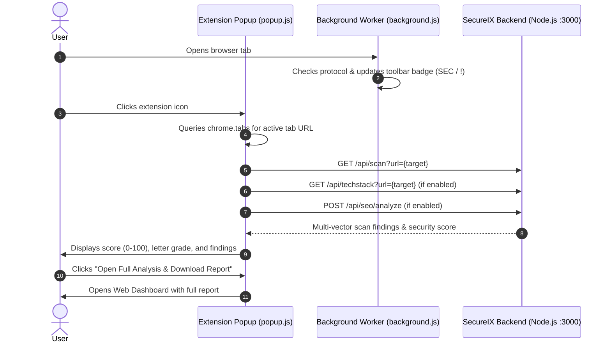

# SecureXI — Quick Security Scanner (Chrome Extension)

A Chrome Extension (Manifest V3) for instant website security posture assessment, SSL/TLS validation, HTTP defense header inspection, phishing threat classification, tech stack discovery, and SEO auditing.

Designed with a high-contrast Neo-Brutalist interface, this companion extension allows security researchers, developers, and users to evaluate any active browser tab or custom target URL directly from the toolbar.

---

## 🚀 Key Features

- **Instant Active Tab Discovery**: Automatically reads the current URL from the active tab and provides immediate security posture metrics.
- **3-in-1 Multi-Engine Scanning**:
  1. **🛡️ Multi-Vector Security Scan**: Evaluates SSL/TLS certificate validity, HTTP security headers (CSP, HSTS, X-Frame-Options), DNS security records (SPF, DMARC), and sensitive file exposures (`.env`, `.git`).
  2. **⚡ Tech Stack & Hosting Detector**: Identifies web servers, frameworks, CMS, and hosting infrastructure in real-time.
  3. **📈 Technical SEO & Performance Audit**: Delivers quick SEO scores and Core Web Vital indicators.
- **Dynamic Browser Badges**: The background service worker dynamically displays badge indicators on tabs (`SEC` for verified HTTPS, `!` for HTTP/insecure targets).
- **Configurable API Endpoints**: Easily configure and toggle between local development (`http://localhost:3000`) and remote production backend API instances.
- **One-Click Deep Scan**: Seamlessly jumps from the lightweight extension popup directly to the comprehensive full-screen web dashboard for detailed breakdown and PDF reports.

---

## 📁 Extension Architecture & File Structure

```text
extension/
├── icons/               # Extension icons (16x16, 32x32, 48x48, 128x128 px & SVG)
│   ├── icon16.png
│   ├── icon32.png
│   ├── icon48.png
│   ├── icon128.png
│   └── icon.svg
├── background.js        # Manifest V3 service worker (badge manager & tab lifecycle)
├── manifest.json        # Extension configuration & permission declarations
├── popup.css            # Neo-brutalist theme & reactive UI styling
├── popup.html           # Extension popup DOM markup & settings drawer
└── popup.js             # Controller logic, Chrome Storage API, and API fetch calls
```

---

## 🛠️ Permissions Declared

The extension requests the minimum required permissions specified in `manifest.json`:

| Permission         | Purpose                                                                                                       |
| ------------------ | ------------------------------------------------------------------------------------------------------------- |
| `activeTab`        | Read the URL of the currently active browser tab upon user interaction                                        |
| `tabs`             | Track tab switching to update the protocol badge (`SEC` / `!`) dynamically                                    |
| `storage`          | Persist user-configured Backend API and Frontend Dashboard URLs                                               |
| `host_permissions` | Allows communicating with target scan endpoints and backend servers (`<all_urls>`, `http://localhost:3000/*`) |

---

## 📥 Installation & Setup Instructions

### 1. Prerequisites

Make sure the **SecureIX Backend** is running before using the extension:

```bash
# In the backend directory:
cd backend
npm run dev
# Running on http://localhost:3000
```

### 2. Load the Extension into Google Chrome (or Chromium-based Browsers)

1. Open **Google Chrome** (or Edge, Brave, Opera, Chromium).
2. Navigate to `chrome://extensions/` in your address bar.
3. Enable **Developer mode** using the toggle switch in the top-right corner.
4. Click the **"Load unpacked"** button in the top-left corner.
5. In the file picker dialog, select the `extension` folder:
   ```text
   c:\Users\m33r\Desktop\web-security-analyzer\extension
   ```
6. The **"SecureXI — Quick Security Scanner"** will now appear in your extensions list.
7. Click the extension puzzle icon in the Chrome toolbar and pin **SecureIX** for quick access.

---

## ⚙️ Configuration & Custom Backend

1. Click the **SecureIX** toolbar icon to open the popup.
2. Click the ⚙️ **Settings** icon in the header.
3. You can customize the target endpoints:
   - **SecureIX Backend API URL**: Default is `http://localhost:3000`.
   - **SecureIX Web Dashboard URL**: Default is `http://localhost:5173`.
4. Click **Save Config** to persist the changes via `chrome.storage.local`.

---

## 🖥️ How It Works


